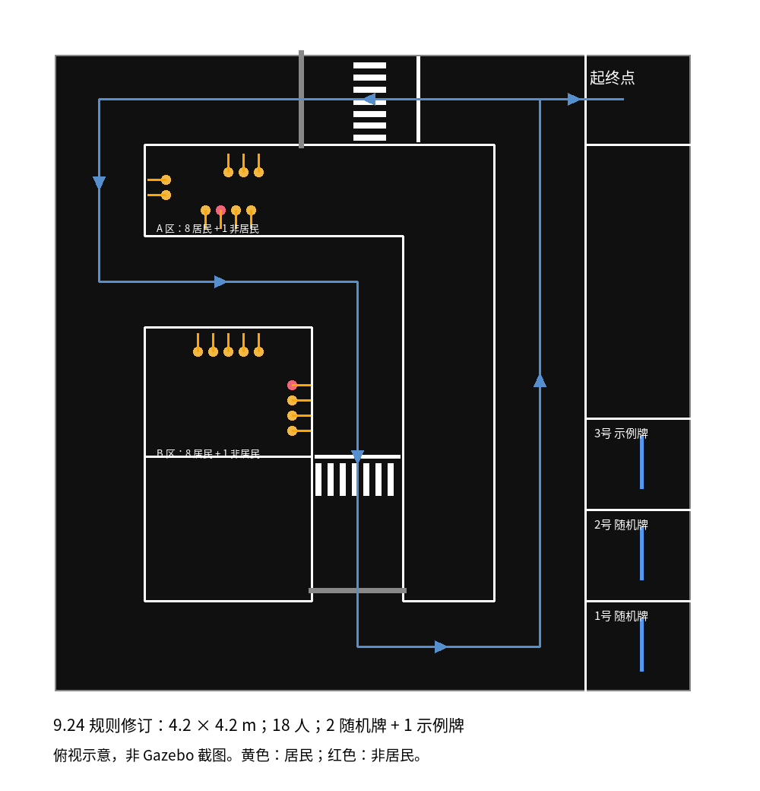

# competition_suanfa · 智慧社区 ROS 仿真工程

基于 **ROS Noetic / Gazebo Classic 11** 的智慧社区比赛仿真工程，包含场地、麦克纳姆机器人、激光定位、导航巡检和 YOLO/OCR 识别。三个 ROS 包、场地纹理、参考地图及三个 ONNX 模型均已包含，首次运行无需重新生成场地或训练模型。

[安装指南](docs/INSTALL.md) · [使用说明](docs/USAGE.md) · [开发与发布](docs/DEVELOPMENT.md) · [模型说明](smart_community_sim/model/README.md) · [来源与许可](THIRD_PARTY_NOTICES.md)



## 功能

- 4.2 × 4.2 m 比赛场地，18 名人物立牌、两处红绿灯、三处车牌。
- 四轮麦克纳姆接触驱动，轮关节编码器里程计、激光雷达和 1280 × 960 相机。
- 默认 `jie_ware` 激光匹配定位与 `my_local_planner` 局部规划器；提供 AMCL、DWA、TEB 对照入口。
- 19 个航点的自主巡检，人物位置关联去重、灯色判断、YOLO 车牌裁剪及 PP-OCRv4 字符识别。
- 黄色终端任务提示、识别置信度、任务汇总和固定目录的验证图片。

## 快速开始

适用环境：**Ubuntu 20.04 x86_64、Python 3.8、ROS Noetic、Gazebo Classic 11**，使用桌面终端和可用的 OpenGL。视觉推理使用 CPU，无需 CUDA、PyTorch 或 Ultralytics。其他操作系统、ARM 和虚拟机性能尚未验收。

Ubuntu 已安装 Git 后执行：

```bash
mkdir -p ~/community_ws/src
git clone https://github.com/RyanYhy/competition_suanfa.git ~/community_ws/src/smart-community
cd ~/community_ws/src/smart-community
bash tools/setup.sh
bash tools/run.sh
```

`setup.sh` 会请求 sudo 安装 ROS/系统依赖，创建工作区 `.venv`，安装固定 Python 依赖，编译三个包并检查模型推理。首次安装需要联网；已有完整系统依赖可用 `bash tools/setup.sh --skip-apt`。默认两个并行编译任务，可加 `--jobs 4`。安装成功会打印 `Ready. Run: ...`；失败时先按 [安装指南](docs/INSTALL.md) 排查。

这里显式将仓库命名为 `smart-community`，与使用说明及源码包一致。目录名可以改变，但仓库须位于 catkin 工作区的 `src/` 下。**不要单独复制一个 ROS 包，也不要复制作者的 build/devel。**

默认启动 Gazebo、RViz、定位导航和视觉并自动开始巡检；`Ctrl-C` 关闭本次运行。

## 常用运行方式

在仓库根目录执行，每次只启动一套仿真：

| 命令 | 用途 |
|---|---|
| `bash tools/run.sh` | 完整自主巡检，打开 Gazebo 和 RViz |
| `bash tools/run.sh --headless` | 关闭两个显示窗口；相机仍需要图形渲染环境 |
| `bash tools/run.sh autostart:=false` | 启动完整系统，等待手动开始巡检 |
| `bash tools/run.sh --manual` | 场地与机器人，另开终端运行键盘控制 |
| `bash tools/run.sh --navigation` | 定位导航，在 RViz 中点选目标 |

[使用说明](docs/USAGE.md) 包含新终端环境加载、巡检启停、键盘操作、结果查看、算法切换、建图和诊断命令。

## 结果目录

首次运行后生成 `smart_community_sim/validation/`，只有三项：

```text
validation/
├── yolo_images/       # 每个观察点的最佳 YOLO 带框图
├── 识别总览.jpg        # 本轮实际图片和任务状态
└── 终端日志.log        # 识别点结果、置信度和末尾任务汇总
```

**新一轮会覆盖上一轮结果。** 终端日志包含运行中的 WARN/ERROR，不含颜色控制字符；图像和日志均不提交 Git。需要逐帧原图、裁剪和导航轨迹时显式加 `diagnostics:=true`，详细数据另存到 `doc/validation/识别调试结果/`。

## 验证状态与已知问题

2026-10-10，在同一台 Ubuntu 20.04 主机上将源码包移到新路径，使用已有 ROS 系统依赖和新建 Python venv 验证：

| 项目 | 结果 |
|---|---|
| 三个包独立编译、55 项离线回归 | 通过 |
| 三个 YOLO CPU 推理、示例车牌 OCR | 通过 |
| Gazebo 在线启动、传感器、定位 TF、视觉服务 | 通过 |
| 自主巡检路线 | 19/19 航点完成，两处路口均到达出口 |
| 三处车牌 | 闽D5070Z、苏D7070A、苏APL12A |
| 人物数量 | A/B 各确认 9 个独立人物 |
| 人物类别与完整视觉验收 | **未通过**：A 区非社区人员被误判为社区人员；A 为社区9/非社区0，B 为社区8/非社区1 |

默认地图由场地碰撞几何生成，**不是实际 SLAM 验收地图**。实际 SLAM、实车、另一台电脑及全新操作系统的 apt 安装分支尚未验收。轮子低速接触响应、局部规划与人物分类仍存在重复运行波动，以每次终端任务汇总为准。

ROS Noetic 已结束官方维护，本工程固定 ROS 1 环境用于复现现有实验，不是 ROS 2 工程。[ROS 官方说明](https://discourse.ros.org/t/ros-noetic-end-of-life-may-31-2025/43160)

## 工程结构

| 目录 | 内容 |
|---|---|
| `smart_community_sim/` | 仿真场地、底盘插件、参考地图、导航配置、视觉与巡检任务 |
| `jie_ware/` | 激光定位适配源码，保留上游 GPL 许可 |
| `my_local_planner/` | 用户局部规划器适配源码 |
| `tools/` | 安装、启动、依赖检查、在线启动检查及源码打包 |
| `docs/` | 对外安装、使用和开发指南 |
| `doc/` | 工程学习笔记与历史实验说明 |

历史笔记中的工作区路径和验证报告属于当时实验；原始报告、日志、比赛 PDF 和原始素材目录不随源码分发。运行所需纹理已经包含。当前操作以 `docs/` 为准。

## 开发、打包与来源

更新代码后重新编译并重启相关节点；提交时排除运行结果、编译产物及原始资料。执行 `python3 tools/package_release.py` 可生成干净源码目录、ZIP 和校验清单，具体步骤见 [开发与发布](docs/DEVELOPMENT.md)。

本仓库保留不同代码、模型和素材的原有来源与许可声明，未新增覆盖整个仓库的统一开源许可。详见 [THIRD_PARTY_NOTICES.md](THIRD_PARTY_NOTICES.md)。
