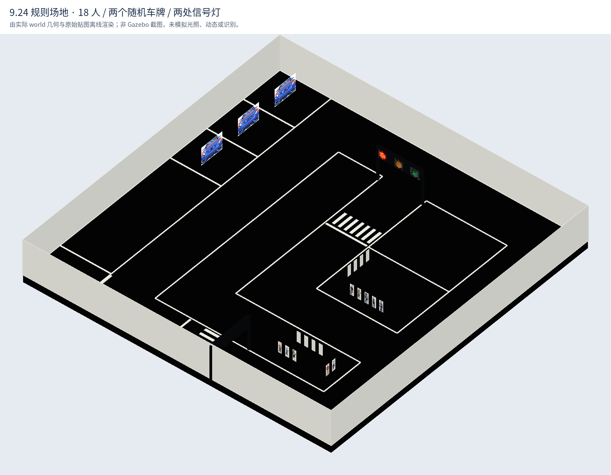
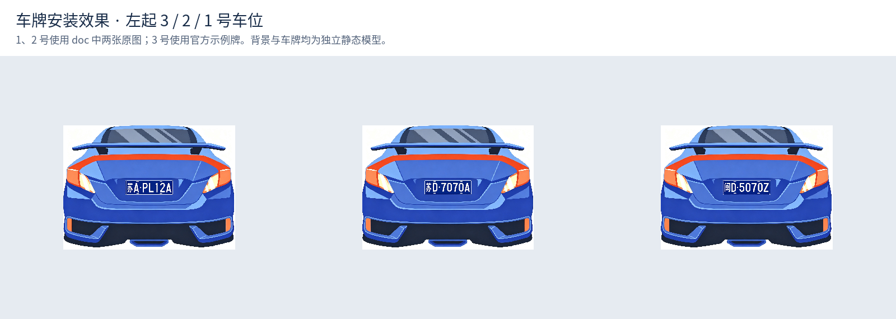

# 9.24 规则场地修订与查看

日期：2026-10-08。按用户要求，本轮仅修改 Gazebo 场地；YOLO 模型由用户稍后提供，导航定位在场地确认后处理。

## 已完成

- 场地地板 4.2 × 4.2 m，保留官方黑底白线、道路拓扑、A/B 区、两处信号灯和右侧三个车位。围墙内表面仍在 ±2.1 m，采用建议高 50 cm、厚 0.5 cm。
- 使用全部 16 名社区人员及 2 名非社区人员，各为独立静态模型；每区 8 名社区人员、1 名非社区人员。人物背板高 15 cm、宽 5 cm、厚 5 mm，可见实体与碰撞体尺寸一致。人物原图按比例居中，不拉伸、不裁切；原始素材不改动。
- 车背景宽 34.5 cm、高 25 cm、厚 0.5 mm。三个车牌均为独立静态模型，宽 9.5 cm、高 3 cm、厚 0.1 mm，带实体与碰撞体，安装在背景正面。1、2 号车位分别使用用户的 `doc/随机车牌1`、`doc/随机车牌2`，3 号为官方第三张牌。两张无扩展名文件经检测确认为 PNG，打包纹理与原图逐字节一致。
- 两个信号灯总宽 64 cm、总高 48 cm、厚 5 cm；箱体宽 59 cm、高 14 cm、厚 5 cm；两侧立柱高 48 cm、截面 2.5 × 2.5 cm。取消超出整体厚度的长脚座，保留静态支撑立柱。红黄绿三个灯面同时存在，world 配置红 10 s → 绿 15 s → 黄 5 s，沿用已有切换插件。
- 更新场景生成器、实际 world、素材打包、场景清单、俯视图和默认 GUI 观察角度。两张随机牌只进入场地纹理，没有添加到旧识别器模板库。

人物数量不再按示意图中少量人形图标决定；人物宽度优先采用 PDF 第 5 页的明确 5 cm 规则。三个车位中使用两个随机牌的解释沿用此前核对记录。人员在区内的精确坐标与车牌安装高度仍为仿真取值。

## 查看效果





其他视图：[俯视布局](../smart_community_sim/field_layout.png)、[18 个人物立牌正面](../smart_community_sim/preview/people.png)、[信号灯正面](../smart_community_sim/preview/signal.png)。这些图片由实际 world 的几何与纹理离线生成，非 Gazebo 截图，不包含动态物理、传感器或识别效果。

关闭旧 Gazebo/roslaunch 后，在本机终端执行：

```bash
source ~/suanfa_ws/devel/setup.bash
roslaunch smart_community_sim field.launch
```

本轮没有修改 C++ 插件，已有工作区编译成功的情况下无需重新编译。此入口只展示场地，不启动机器人、识别和导航。查看时：A/B 区应各有 9 个独立立牌；沿右侧从下往上的 1、2 号车位为随机牌，3 号为示例牌；两个灯架均有完整立柱，运行一个 30 秒仿真周期可观察三色切换。检查车牌和人物正面时可旋转、拉近 Gazebo 视角。

## 验证与后续范围

- `libsdformat9` 直接解析比赛 world 和测试 world 均成功，没有启动 ROS/Gazebo 服务。
- 场地静态核验 156 项通过，包括物料尺寸、人数、人物不重叠且不越街区边界、车牌前后安装关系、灯面和周期配置、贴图路径及原图一致性。核验脚本与 JSON 在 `validation/20261008_field_revision/`。
- 更新后的官方资料回归测试 9 项通过。其中旧视觉测试仅验证原有示例素材，不能证明随机牌或 YOLO 识别能力。
- 文件摘要确认：机器人、底盘控制、导航参数、导航地图、旧视觉代码及 `drive_test.world` 均未改变。围墙和灯架几何改变后，旧导航参考地图需要在下一阶段重新生成并核验；本轮没有调导航。
- 当前执行环境不能启动 ROS/Gazebo 所需服务，未进行 GUI、实际相机或灯色动态验收。静态预览不替代本机查看。

此前停车时车体漂移问题继续保留待处理，本轮场地修改不代表其已修复。待用户确认场地并提供模型后，再按用户安排开展识别和导航定位工作。
